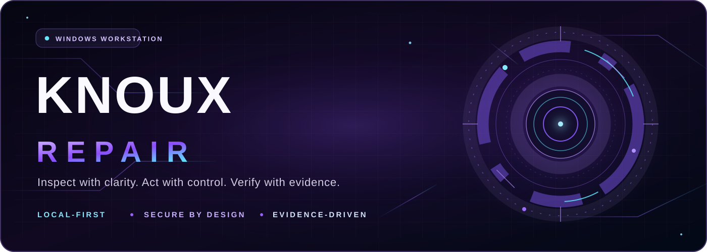
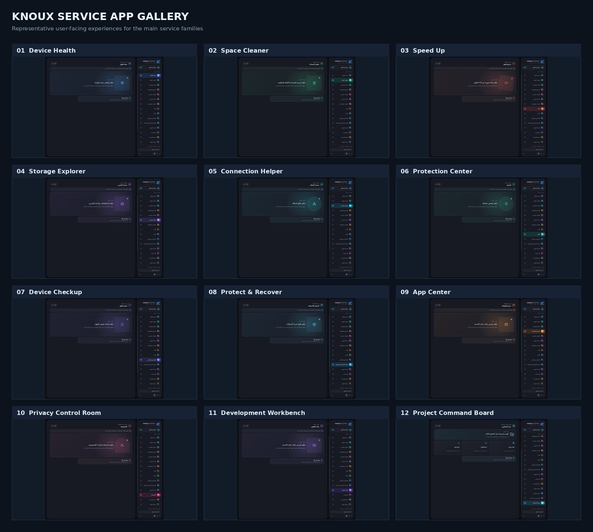
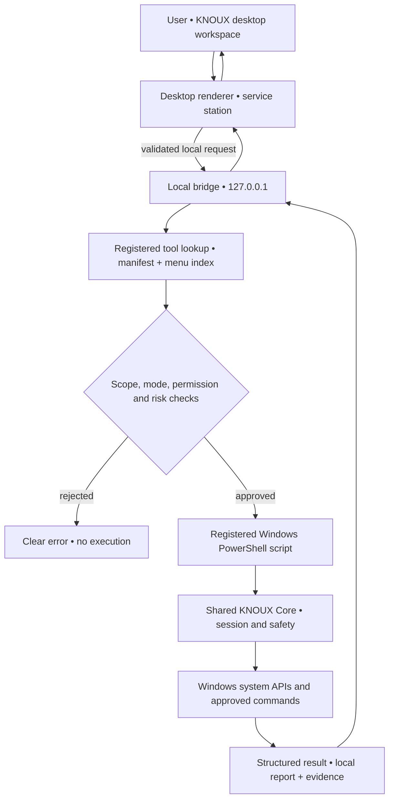

<!-- KNOUX Repair · repository landing page · GitHub Flavored Markdown -->
<!-- Brand artwork: Docs/assets/knoux-readme-hero.svg · Product identity and contacts are owner supplied. -->

<div align="center">

<a href="https://knoux.store/" title="Official KNOUX website">
  
</a>

# KNOUX Repair

**The Windows care workstation built around control, clarity, and evidence.**

<a href="https://knoux.store/">KNOUX Official Website</a> · <a href="README-EN.md">English Guide</a> · <a href="README-AR.md">الدليل العربي</a> · <a href="ARCHITECTURE.md">Architecture</a> · <a href="CONTRIBUTING.md">Contribute</a>



<p>
  
  
  
  
  
  
</p>

[](https://github.com/daynightae-cmyk/knoux-Repair/actions/workflows/ci.yml)
[](SECURITY.md)

**Explore the product · Understand the technology · Operate responsibly**

[Product overview](#the-product) · [Service atlas](#the-complete-service-atlas) · [Getting started](#getting-started) · [Safety](#safety-is-a-product-feature) · [KNOUX & founder](#knoux--the-people-behind-the-product)

</div>

> [!IMPORTANT]
> **Product truth, not marketing fiction.** The 6 families / 18 services / 158 tools describe the repository's **registered catalog**, not 158 individually verified successful operations on every computer. Actual availability, privilege needs, and results depend on the machine, tool contract, and local runtime. Refer to [the service inventory](Docs/SERVICE-INVENTORY.md) and [known limitations](Docs/KNOWN-LIMITATIONS.md) before treating a workflow as production-verified.

---

## Navigation

| Discover | Build & operate | Trust & community |
|:--|:--|:--|
| [The product](#the-product) | [Getting started](#getting-started) | [Safety model](#safety-is-a-product-feature) |
| [Experience & gallery](#experience--visual-identity) | [Project structure](#repository-map) | [Truth & evidence](#anatomy-of-a-trustworthy-operation) |
| [Six service families](#six-families-one-workstation) | [Windows console](#powershell-console) | [Privacy & optional AI](#privacy-and-knoux-ai) |
| [18-service atlas](#the-complete-service-atlas) | [Build / package](#build-and-package-locally) | [Known limitations](#known-limitations--engineering-honesty) |
| [Capability highlights](#capability-spotlights) | [Tests & CI](#quality-gates--verification) | [Contributing](#contributing) |
| [Architecture](#architecture--execution-model) | [Troubleshooting](#troubleshooting) | [Founder & contact](#knoux--the-people-behind-the-product) |
| [FAQ](#frequently-asked-questions) | [Documentation index](#documentation-library) | [Languages](#documentation-languages) |

---

<a id="the-product"></a>
## 01 · The product

**KNOUX Repair** is a Windows-focused, local-first diagnostics and maintenance workbench. It connects a designed desktop experience to registered system tools through a constrained local execution layer. Its purpose is to make technically complex computer-care tasks understandable, controllable, and attributable to evidence.

KNOUX is not intended to be a decorative system monitor. Its engineering model favors **inspection before intervention**, **explicit human approval before risky changes**, and **honest results after execution**. The underlying operations are real Windows tools, not animated success messages or fabricated machine telemetry.

### The principles behind every workflow

| Principle | How KNOUX approaches it |
|:--|:--|
| **Know before changing** | Where supported, inspect, preview, or analyze before applying a repair. |
| **Explicit intent** | A user action selects a registered capability; UI decoration is never authority to mutate the computer. |
| **Windows security boundary** | Administrator-only operations must pass the actual UAC/elevation rules. |
| **Bounded scope** | File targets, protected paths, runtime inputs, and execution modes are checked. |
| **Recoverability where possible** | Quarantine, backup, restore points, and verification are used by supported operations. |
| **Evidence over optimism** | Running, failure, cancellation, warning, and inconclusive are meaningful states. |
| **Local by default** | Windows repair remains on the local machine; optional remote integrations are not required for core maintenance. |
| **A coherent product** | System maintenance, storage, software, diagnostics, and developer tools share a single service model. |

### At a glance

| Repository fact | Current description |
|:--|:--|
| Current version | `2.0.3` ([VERSION](VERSION), [changelog](CHANGELOG.md)) |
| Target system | Windows workstation |
| Product organization | 6 families → 18 services → 158 registered tool IDs |
| Core execution | Registered PowerShell tools behind a local bridge |
| Main checked-in desktop surface | Electron shell with a React/TypeScript renderer |
| Additional maintained surfaces | PowerShell console; historical/native Windows project artifacts documented separately |
| Development gateway | Local-only, at `127.0.0.1` |
| Built-in data safety | Risk metadata, mode validation, confirmation, elevation guard, evidence reports |
| Languages | English and Arabic, including UI RTL considerations |
| Optional services | Configured OAuth and AI/cloud integrations where enabled |

The presence of web technologies in the source tree **does not make KNOUX a cloud-hosted repair service**. Its supported desktop/tool workflow is built around local execution. No remote host should be given access to the local bridge.

---

<a id="experience--visual-identity"></a>
## 02 · Experience & visual identity

The product's visual DNA is deliberate: **deep-space surfaces, violet energy, cyan precision accents, disciplined glass depth, readable typography, and evidence-oriented workspaces**. The interface aims to make the next useful operation clear without concealing technical detail from those who need it.

<div align="center">
  
  <sub>Existing KNOUX Core brand artwork · source: <a href="web-frontend/public/brand/knoux-home-core.png">repository asset</a>. Brand art is not live telemetry.</sub>
</div>

### Service experience gallery

<div align="center">
  
  <sub>Service-application gallery stored in <a href="Docs/KNOUX-SERVICE-APP-GALLERY.png">Docs/KNOUX-SERVICE-APP-GALLERY.png</a>. Individual screen behavior should be verified against the current Windows runtime.</sub>
</div>

This README uses the **owner-supplied corporate logo** above, the **repository's existing brand artwork**, and an original GitHub-compatible SVG hero. It does not manufacture a screenshot, performance score, review rating, or AI result.

### What makes the experience different?

- **Family-first navigation:** begin with an outcome such as system health, storage recovery, or project analysis.
- **Context-specific workspaces:** specialized service stations can display their own scope, findings, actions, and results.
- **KNOUX Core / operational identity:** a recognizable control-room visual language, never a replacement for actual execution.
- **Local evidence:** reports and verified results are traceable to the operation that generated them.
- **Human-readable feedback:** inaccessible Windows data stays unavailable or inconclusive instead of being replaced by fake values.
- **Safe default posture:** inspection and recovery options matter more than making a dangerous operation one click away.

For the implementation vision and current maturity, read [the service inventory](Docs/SERVICE-INVENTORY.md), [the consumer service catalog](Docs/PLATFORM-SERVICE-CATALOG.md), and [the architecture](ARCHITECTURE.md).

---

<a id="six-families-one-workstation"></a>
## 03 · Six families. One workstation.

| Family | Mission | Services | Registered tools |
|:--|:--|:--:|--:|
| **System Vitality** | Diagnose, maintain, measure performance | 3 | **26** |
| **Recovery & Storage** | Clean, find duplicates, understand disks, protect data | 4 | **37** |
| **Assurance** | Network, security, privacy, and device drivers | 4 | **29** |
| **Software Library** | Programs, runtimes, setup after Windows installation | 3 | **24** |
| **Engineering Workbench** | Developer diagnostics and project intelligence | 2 | **20** |
| **Investigation** | Diagnostics, reports, services, and process evidence | 2 | **22** |
| **TOTAL** | Canonical catalog, not a blanket compatibility promise | **18** | **158** |

These values come from the repository's architecture and canonical manifest. The family is the user-facing navigation concept; the service owns its subject-specific experience; the individual tool ID is an internal execution contract.

---

<a id="the-complete-service-atlas"></a>
## 04 · The complete service atlas

The catalog below is a practical map of **what each service is designed to investigate or support**. It is intentionally more useful than a wall of 158 unexplained script names. Capability depth varies; always inspect the safety metadata and the per-service readiness matrix.

### A · System Vitality — understand the health of Windows

| # | Service | IDs | What you can investigate or do |
|:--:|:--|--:|:--|
| 01 | **System Maintenance** | 10 | Windows component health, integrity checks, repair preparation, maintenance evidence, and verified registered actions. |
| 08 | **Performance** | 12 | Performance snapshots, memory and resource observations, startup-related analysis, and supported optimization workflows. |
| 15 | **System Monitoring** | 4 | Local system activity and process/resource observations with meaningful samples and timestamps. |

**The user journey:** inspect a symptom → understand current evidence → review the supported operation → confirm if required → obtain a result. A general “health score” is never a substitute for source-backed measurements.

### B · Recovery & Storage — protect what matters

| # | Service | IDs | What you can investigate or do |
|:--:|:--|--:|:--|
| 02 | **System Cleanup** | 11 | Discover cleanup candidates, review their scope, perform supported safe cleanup, and inspect evidence. |
| 05 | **Duplicate Files** | 11 | Scan selected paths, group verified duplicate content, make deliberate decisions, and use supported quarantine/restore flows. |
| 06 | **Disk Space** | 10 | Inspect capacity, file-space consumption, storage observations, and eligible space-management actions. |
| 11 | **Backup & Recovery** | 5 | Review supported backup/restore-point information and the recovery actions actually available in the environment. |

**The user journey:** select scope → inspect findings → choose precisely → preserve a recovery path where available → execute only after approval → verify. KNOUX does not promise to recover arbitrary deleted data.

### C · Assurance — connection, security, privacy, trust

| # | Service | IDs | What you can investigate or do |
|:--:|:--|--:|:--|
| 03 | **Network & Internet** | 11 | Adapter state, connectivity diagnostics, relevant Windows network settings, and supported repairs. |
| 09 | **Security** | 10 | Windows security posture, firewall/defender evidence where available, and governed repair actions. |
| 13 | **Privacy** | 4 | Inspect supported local privacy settings and review explicitly scoped changes. |
| 14 | **Driver Management** | 4 | Enumerate Windows drivers and devices, inspect available metadata, and use supported export/maintenance actions. |

**The user journey:** gather current device evidence → distinguish verified conditions from unavailable providers → review risk → act only within supported privilege and recovery rules.

### D · Software Library — build a ready-to-use machine

| # | Service | IDs | What you can investigate or do |
|:--:|:--|--:|:--|
| 04 | **Programs & Applications** | 10 | Discover installed applications and available management actions, with verification requirements for changes. |
| 16 | **Software Environment** | 8 | Inspect runtimes, installed toolchains, development prerequisites, and environment evidence. |
| 17 | **Post-Install Setup** | 6 | Support setup after a Windows installation: inventory, verified package selection, queues, and readiness checks where implemented. |

**The user journey:** inspect the machine → identify missing software or runtimes → select only supported actions → execute via approved provider → verify the resulting installation state.

### E · Engineering Workbench — inspect the developer environment

| # | Service | IDs | What you can investigate or do |
|:--:|:--|--:|:--|
| 12 | **Developer Tools** | 13 | Explore developer toolchain state, active development ports, local environments, and supported diagnostic utilities. |
| 18 | **Project Sonar** | 7 | Select a local project, inventory recognizable project structure, inspect findings, and produce bounded analysis/evidence. |

**The user journey:** choose an actual local workspace → inspect real source/manifests/metadata → understand findings → export or act on supported recommendations. A repository or its Git status is not invented for demo purposes.

### F · Investigation — turn observations into evidence

| # | Service | IDs | What you can investigate or do |
|:--:|:--|--:|:--|
| 10 | **Diagnostics & Reports** | 11 | Collect Windows diagnostic evidence and produce intelligible operation/report output. |
| 07 | **Services & Processes** | 11 | Inspect running processes, Windows services, status information, and supported safeguarded service actions. |

**The user journey:** choose a diagnostic subject → collect evidence → inspect the actual result → identify the safest next action. Critical processes and services are not arbitrary targets for termination.

> [!NOTE]
> A registered tool is not necessarily usable without Administrator privileges, system provider support, a supported operating mode, or the correct environment. “Registered” means the tool is represented in the canonical catalog; **runtime success is a separate fact**.

---

<a id="capability-spotlights"></a>
## 05 · Capability spotlights

### System inspection and repair

KNOUX separates **analysis** from **mutation**. The registered tool metadata determines whether a specific operation supports `AnalyzeOnly`, `WhatIf`, or actual execution. The bridge must reject unsupported execution modes instead of silently attempting another mode.

*Useful when:* Windows components are unhealthy, a system tool produces actionable evidence, or a technician needs to understand the expected repair before approval.

### Duplicate intelligence and quarantine

The repository contains a dedicated duplicate-file service and a local engine/persistence path. Its design distinguishes candidate matching from verified content identity, requires selected scan roots, and places safe decisions ahead of removal. Restore behavior must account for path collisions.

*Useful when:* freeing space **without** assuming that two files are duplicates merely because their names match. See the [duplicate engine and safety contracts](ARCHITECTURE.md).

### Post-install readiness

The software family supports inventory and setup workflows for a Windows workstation. WinGet-based package identity and live installation state must be checked against real providers, not hard-coded as installed.

*Useful when:* preparing a fresh Windows installation, documenting existing runtimes, or reviewing a controlled application-setup queue.

### Project Sonar and developer diagnostics

Project Sonar identifies project markers, collects scoped workspace information, and attributes findings to the selected project. Developer Tools adds the complementary machine-side picture: available toolchains, ports, and locally observed environment facts.

*Useful when:* checking an engineering workstation or making project evidence more legible before handoff.

### Evidence-first reporting

A successful invocation does not automatically mean a successful repair. The result contract includes measured outcomes and a distinct verification field, and may conclude with warning, failure, cancellation, skipped, or inconclusive status.

*Useful when:* a technical report must survive code review, machine troubleshooting, or a future maintenance decision.

### KNOUX AI — assist, do not impersonate the machine

Where explicitly configured, AI can assist with explanation or interpretation of bounded evidence. The local bridge remains authoritative for actual system actions. AI presence is **not** proof that a remote model is configured, reachable, or permitted to receive machine data.

*Useful when:* translating technical evidence into clearer language while retaining human review and local safety policy. See [privacy and KNOUX AI](#privacy-and-knoux-ai).

---


<a id="architecture--execution-model"></a>
## 06 · Architecture & execution model

KNOUX Repair is a **Windows-local execution product**, not a hosted dashboard that pretends to repair another machine. The principal checked-in product surface is an Electron desktop application; its renderer is separate from the trusted local bridge and Windows tool execution.



The diagram is **conceptual architecture**, not evidence that an action ran. The real source of truth is [ARCHITECTURE.md](ARCHITECTURE.md), [the API inventory](Docs/API-INVENTORY.md), [the executable manifest](Docs/TOOLS-MANIFEST.json), and [the safety model](Docs/SAFETY-MODEL.md).

### Execution boundaries

| Layer | Responsibility | What it must not do |
|:--|:--|:--|
| Desktop UI | Choose a service, gather input, show results | Invent Windows state, access arbitrary privileged system APIs |
| Local bridge | Authenticate/authorize, normalize, validate, start registered operations | Offer an unrestricted command-execution endpoint |
| Manifest / menu index | Define canonical tool IDs and registered script targets | Treat an unregistered script as executable |
| PowerShell Core | Create sessions, enforce policy, collect result evidence | Convert script failure into fake success |
| Windows host | Perform the requested OS operation subject to Windows privileges | Be assumed identical across all computers |
| Report/evidence | Describe what actually occurred and what was verified | Mistake a historical report for a currently running task |

### Why loopback-only matters

The local execution bridge is designed for `127.0.0.1`. It is not a public service, and it must not be rebound to a LAN address, port-forwarded, or exposed through a tunnel. Browser or renderer requests alone do not grant authority to run arbitrary commands.

### The canonical service inventory

The repository uses [`Docs/TOOLS-MANIFEST.json`](Docs/TOOLS-MANIFEST.json) and [`Config/menus.json`](Config/menus.json) for registered execution truth. The UI may present a friendly name and an accessible explanation, but underlying operations must still resolve to a valid registered capability and supported action.

---

<a id="safety-is-a-product-feature"></a>
## 07 · Safety is a product feature

Windows maintenance can change or remove data. KNOUX therefore treats trust boundaries and recoverability as engineering requirements, not legal footnotes.

### Risk-aware operations

| Risk class | Meaning | Expected behavior |
|:--|:--|:--|
| `READ_ONLY` | Inspect data | No system mutation |
| `SAFE_CLEANUP` | Bounded cleanup | Review scope and use supported quarantine safeguards |
| `SYSTEM_REPAIR` | System-state repair | Explicit confirmation and privilege checks where applicable |
| `DESTRUCTIVE` | Hard-to-reverse change | Strong confirmation, protected-path checks, and appropriate backup safeguards |
| `REBOOT_REQUIRED` | Change completed later by Windows | Disclose the reboot dependency and verify when possible |
| `WINRE_ONLY` | Requires Windows Recovery Environment | Never pretend an online Windows session can perform it |

### Seven non-negotiable safety behaviors

1. **Inspect first when supported.** Use `AnalyzeOnly` or `WhatIf` only for tools whose contracts implement those modes.
2. **Confirm before mutation.** A risky tool requires an explicit, contextual user approval path.
3. **Respect Windows UAC.** `RequiresAdmin` cannot be bypassed by the renderer or local HTTP bridge.
4. **Validate every target.** Selected folders, paths, input parameters, and protected resources are constrained.
5. **Prefer reversible changes.** Quarantine, restore points, backups, or exported state are used when the particular tool supports them.
6. **Report actual outcomes.** Do not describe an attempted action as completed before evidence supports it.
7. **Keep control local.** Do not expose repair execution to untrusted remote hosts or silently send private machine data off-device.

### Administrator access

If an operation requires elevation and the bridge is not elevated, the expected response is **`403 ELEVATION_REQUIRED`**. The user must grant privileges through the ordinary Windows approval flow. Elevated mode is not the default answer to every problem: inspect risk and scope first.

### Protected resources and recovery

- [Protected paths](Config/protected-paths.json) and [protected processes](Config/protected-processes.json) establish sensitive resource policies.
- [Safety model](Docs/SAFETY-MODEL.md) documents confirmation, quarantine, rollback considerations, and UAC boundaries.
- [English restore guide](Docs/RESTORE-GUIDE-EN.md) and [دليل الاستعادة](Docs/RESTORE-GUIDE-AR.md) explain the supported restoration approach.

> [!CAUTION]
> This is real maintenance software. Do not run destructive or elevation-dependent tools on an important machine merely to demonstrate the interface. Validate on suitable test data or a recoverable test machine first.

---

<a id="anatomy-of-a-trustworthy-operation"></a>
## 08 · Anatomy of a trustworthy operation

```text
Select a service
      │
      ▼
Choose a registered tool and scope
      │
      ▼
Analyze / Preview (when supported)
      │
      ▼
Review risk and expected effect
      │
      ▼
Confirm and elevate only if required
      │
      ▼
Execute the real Windows operation
      │
      ▼
Collect result, error, and verification evidence
      │
      ▼
Show the truthful final state and local report
```

### Run lifecycle

A long task may start as an asynchronous run, return a run identifier, and continue to be checked without blocking the desktop UI. A timed-out browser interaction is not automatically a failed PowerShell operation.

The runtime must distinguish **preparing**, **running**, **waiting for confirmation/elevation**, **success**, **warning**, **failure**, **cancelled**, **skipped**, and **inconclusive**, as applicable. “Verification not performed” is a valid outcome; it must not be silently rewritten as verified.

### Seven-entry report structure

The shared Core contract described in [ARCHITECTURE.md](ARCHITECTURE.md) records a run under a timestamped local report folder containing:

```text
Reports/<timestamp>-<TOOLID>/
├── operation.log
├── errors.log
├── results.json
├── results.csv
├── summary-en.txt
├── summary-ar.txt
└── raw-output/
```

A run's `runId` correlates the bridge request with the corresponding report. The structured envelope distinguishes **what was found**, **what was processed**, **whether the system changed**, and **whether verification occurred**.

**Trust contract:** if a report says SUCCESS, it must be the output of a real operation, not the output of a progress animation.

---

<a id="getting-started"></a>
## 09 · Getting started

This is a **Windows project**. The steps below describe the checked-in developer/runtime workflows, not a claim that every pre-built installer has been released publicly.

### Choose your route

| I want to… | Use |
|:--|:--|
| Run the PowerShell console | [PowerShell console](#powershell-console) |
| Develop or inspect the current desktop app | [Development setup](#developer-setup) |
| Build a local Windows desktop package | [Build and package locally](#build-and-package-locally) |
| Understand tools and privileges before use | [Safety](#safety-is-a-product-feature) |
| Review operating constraints | [Known limitations](#known-limitations--engineering-honesty) |

### Requirements

- **Windows:** the repair tools depend on Windows APIs, services, and commands. Windows 10/11 environment-specific verification is still important.
- **PowerShell:** Windows PowerShell and/or PowerShell 7, depending on the operation and the corresponding script contract.
- **For source development:** Node.js and npm suitable for the repository's package versions; the native WPF/.NET project, where used separately, requires the matching .NET SDK.
- **For privileged repairs:** Administrator approval via the genuine Windows UAC prompt, only where the tool requires it.
- **For optional network services:** the relevant installed provider, network access, and user-controlled configuration.

### Clone the repository

```powershell
git clone https://github.com/daynightae-cmyk/knoux-Repair.git
Set-Location .\knoux-Repair
git status --short
```

Review [ARCHITECTURE.md](ARCHITECTURE.md), [Docs/SAFETY-MODEL.md](Docs/SAFETY-MODEL.md), and [Docs/KNOWN-LIMITATIONS.md](Docs/KNOWN-LIMITATIONS.md) before initiating real system changes.

<a id="developer-setup"></a>
### Developer setup · existing desktop source

From the repository root:

```powershell
npm --prefix web-frontend ci
npm --prefix web-frontend run typecheck
npm --prefix web-frontend run build
```

To start the checked-in desktop development workflow:

```powershell
npm --prefix web-frontend run desktop:dev
```

To run the local development gateway instead:

```powershell
npm run dev
```

The development UI is ordinarily served on `http://127.0.0.1:3000`, and the local execution bridge is designed around `127.0.0.1:8787`. Those are **local development interfaces, not deployment endpoints**. Use the real bridge; never substitute fabricated system responses for real testing.

<a id="powershell-console"></a>
### PowerShell console

The repository also maintains a native Windows scripting interface:

```powershell
.\START-KNOUX-REPAIR.cmd
```

Or:

```powershell
powershell -NoProfile -ExecutionPolicy Bypass -File ".\Menu.ps1"
```

The command shows the repository's console launcher. It is **not** a blanket recommendation to bypass your organization's PowerShell policy; use approved execution policy and signing controls for your environment. Only run tools you understand and intend to run.

### Working with analysis and preview modes

When a registered script supports the relevant switches, the console or selected tool can offer `-AnalyzeOnly` / `-WhatIf`. Mode support belongs to the **specific tool**. An unsupported mode should be rejected rather than simulated.

---

<a id="build-and-package-locally"></a>
## 10 · Build and package locally

The checked-in desktop package script builds the renderer and produces a Windows installer through Electron Builder / NSIS. This does **not** require publishing a hosted web application.

```powershell
npm --prefix web-frontend ci
npm --prefix web-frontend run desktop:package
```

The package metadata names the installer `KNOUX-Repair-Setup-<version>.exe` and points the build output to `Release/KNOUX-Repair/`. The final filename and artifact must be checked after an actual successful package run; do not infer that an installer exists solely because packaging is configured.

For the repository's additional installer scripts and native artifacts, review [BUILD-KNOUX-REPAIR-INSTALLER.ps1](BUILD-KNOUX-REPAIR-INSTALLER.ps1), [Installer/](Installer/), and the historically scoped [QA release report](QA-RELEASE-REPORT.md). Historical evidence for v2.0.2 is not automatically proof for the current v2.0.3 build.

### Installation and distribution discipline

- Prefer trusted, reviewed build outputs.
- Inspect the installer version and hashes before distribution.
- Confirm Windows SmartScreen/signing status; do not claim a signature exists without checking it.
- Treat local repair privileges with more care than ordinary application privileges.
- Do not distribute unpublished builds as “verified releases.”
- Preserve local user reports, quarantine data, and recovery artifacts during upgrades wherever the product's versioned migration rules require it.

[Explore repository releases](https://github.com/daynightae-cmyk/knoux-Repair/releases) — availability of a downloadable release must be verified on that page.

---

<a id="repository-map"></a>
## 11 · Repository map

```text
knoux-Repair/
│
├── README.md                    ← GitHub landing page
├── README-EN.md                 ← English operational guide
├── README-AR.md                 ← دليل التشغيل بالعربية
├── ARCHITECTURE.md              ← execution and trust boundaries
├── CONTRIBUTING.md              ← engineering contribution rules
├── CHANGELOG.md                 ← version history
├── VERSION                      ← current version
│
├── 01-System-Maintenance/       ┐
├── 02-System-Cleanup/           │
├── ...                          ├── 18 canonical service folders
├── 18-Project-Sonar/            ┘
│
├── Core/                        ← shared PowerShell safety / session modules
├── Config/                      ← menu index and protected resources
├── Docs/                        ← manifests, QA, safety, release evidence
│   └── assets/                  ← GitHub README decorative artwork
├── Tests/                       ← PowerShell and integration tests
├── Installer/                   ← Windows packaging and branding
├── web-frontend/
│   ├── desktop/                 ← Windows desktop shell
│   ├── public/brand/            ← existing KNOUX brand art
│   ├── src/                     ← interface and station implementations
│   ├── server/                  ← local bridge and operational engines
│   ├── tests/                   ← frontend / bridge contract suites
│   └── scripts/                 ← QA and visual capture utilities
├── Menu.ps1                     ← PowerShell console menu
└── START-KNOUX-REPAIR.cmd       ← console launcher
```

The architecture may contain additional source, database, and installer projects beyond this intentionally condensed orientation map. The links above are the stable entry points for an engineer auditing the current code.

---


<a id="quality-gates--verification"></a>
## 12 · Quality gates & verification

“Build passes” is necessary but **insufficient** to declare Windows repair software production-ready. KNOUX verification spans source, execution, safety, rendering, and actual Windows behavior.

### Source-level developer gate

```powershell
npm --prefix web-frontend run typecheck
npm --prefix web-frontend test
npm --prefix web-frontend run build
npm --prefix web-frontend audit --omit=dev --audit-level=high
git diff --check
```

These commands are documented repository workflows, **not results freshly executed by this README update**. A previous “822/822” snapshot in an October 2026 audit is historical evidence, not a current live test assertion.

### What GitHub Actions covers

The [Windows CI workflow](.github/workflows/ci.yml) includes dependency installation, source validation, tests, build, rendered UI evidence scripts, and Windows-specific checks. Follow the **actual** workflow and run logs for each commit; the badge above reflects the workflow status returned by GitHub and is not a substitute for detailed evidence.

### Acceptance matrix

| Gate | What counts as evidence | What does not |
|:--|:--|:--|
| Source integrity | Current commit, manifest consistency, diff checks | “The code looks fine” |
| Type safety | A completed typecheck for the exact SHA | A past run on another branch |
| Automated tests | A completed suite with zero relevant failures | Historical test totals |
| Windows build | Real build/package artifact for the target runtime | Configured scripts only |
| Local bridge | Real startup, health endpoint, registered tool resolution | A mock `ok: true` |
| Safe tool execution | Scoped run ID, result, logs, verification and failure handling | Green animated button |
| Dangerous operations | Explicit risk gates and controlled test environment | Destructive test on a user's machine |
| Visual quality | Actual rendered current app at relevant sizes/RTL states | Marketing artwork |
| Release | Validated installer, constraints, owner-approved distribution | An old “release ready” memo |

### Screenshot evidence versus brand artwork

The **visual assets on this page are for design and product orientation**. Passing the release gate requires screenshots captured from the actual application with known environment, viewport, version, and runtime status.

For evidence and boundaries, see [the deep audit](Docs/DEEP-AUDIT-REPORT-20261020.md), [the tests](Docs/TEST-RESULTS.md), [release evidence](Docs/FINAL-RELEASE-EVIDENCE-20260924.md), and [the service evidence matrix](Docs/SERVICE-EVIDENCE-MATRIX.md).

---

<a id="privacy-and-knoux-ai"></a>
## 13 · Privacy and KNOUX AI

### Local-first is an execution boundary

The system-repair pipeline is local. System diagnostics, protected-resource decisions, reports, and tool runs remain governed by the local machine and bridge. **Local-first does not mean that every optional integration is offline.** A feature that needs an external model, provider, OAuth identity, or software source should communicate that clearly.

### AI is assistance, not authority

Where KNOUX AI is configured and available, its supported role is to explain, summarize, and assist with bounded evidence. It cannot claim to have inspected the system unless a real inspection produced the evidence. It cannot silently perform Windows repair or bypass confirmation and elevation requirements.

Remote/provider availability varies; “configured” is not synonymous with “connected.” See [KNOUX AI integration contract](Docs/KNOUX-AI-INTEGRATION-CONTRACT.md) and [Private MCP status](Docs/PRIVATE-MCP-CLOSURE.md) for engineering constraints.

### Sensitive operational evidence

Logs and reports can contain local paths, installed applications, host details, and diagnostic records. Keep this information private. Before reporting a bug publicly, redact personal paths, identifiers, tokens, credentials, and other sensitive content.

For security concerns, use the contact channel in the [corporate directory](#knoux--the-people-behind-the-product); do not place secrets in public issues.

---

<a id="known-limitations--engineering-honesty"></a>
## 14 · Known limitations & engineering honesty

A sophisticated UI cannot eliminate Windows environmental variability. The [current limitations document](Docs/KNOWN-LIMITATIONS.md) records cases requiring additional environment support or manual testing.

| Area | Important qualification |
|:--|:--|
| Hardware telemetry | SMART and vendor-specific sensor details may be unavailable or incomplete. |
| System providers | CIM/WMI, network, Defender, and driver providers may vary by machine. |
| Elevation | Admin-required operations fail safely without proper Windows permissions. |
| Storage scans | Bounded analysis may intentionally limit scope on extremely large profiles. |
| Recovery | Not every backup or data recovery outcome is available on all machines. |
| Network-dependent work | Windows Update, software sources, cloud models, and OAuth need their own conditions. |
| Runtime testing | Real reboot/rollback and some destructive end-to-end paths require manual test environments. |
| Accessibility | Broader screen-reader, keyboard, and locale acceptance still needs representative Windows validation. |
| UI maturity | Some specialized service workflows have documented experience/depth gaps. |

**We do not claim “every tool fixes every PC.”** The right outcome may be *nothing detected*, *permission required*, *inconclusive*, *requires restart*, or *operation failed with useful evidence*. An honest failure is more valuable than fabricated success.

---

<a id="troubleshooting"></a>
## 15 · Troubleshooting

<details>
<summary><strong>The desktop opens but shows a local bridge / service problem</strong></summary>

Check whether the local bridge started, whether loopback access is allowed, and whether the configured local port is available. Verify the actual response of the local health endpoint rather than assuming the UI's previous status is still current. Review [architecture](ARCHITECTURE.md) and [known limitations](Docs/KNOWN-LIMITATIONS.md).

</details>

<details>
<summary><strong>An action reports ELEVATION_REQUIRED</strong></summary>

The operation requires Administrator privileges and the current bridge lacks them. Confirm the tool's risk, preview the intended change if supported, then use the standard Windows elevated launch/UAC flow. Never try to bypass the check.

</details>

<details>
<summary><strong>The tool ran but the result is INCONCLUSIVE</strong></summary>

This is a supported truthful terminal status. Inspect the report, raw evidence, provider limitations, and verification fields. Do not rerun a mutating command indiscriminately.

</details>

<details>
<summary><strong>A package or driver inventory is incomplete</strong></summary>

Check which Windows inventory providers exist and which permissions apply. Provider failure or unavailable hardware telemetry must not be replaced with guessed software or device state.

</details>

<details>
<summary><strong>A duplicate scan finds fewer files than expected</strong></summary>

Verify the selected roots, filters, inaccessible folders, protected exclusions, and bounded scan limits. Do not extend a scan to unrelated drives without explicit user scope.

</details>

<details>
<summary><strong>The UI test or browser interaction timed out</strong></summary>

Check the canonical backend run identifier and final status, then distinguish UI timeout from tool failure. For longer operations, the desktop must remain responsive and obtain the real terminal state.

</details>

<details>
<summary><strong>Installer packaging fails</strong></summary>

Check the precise build log and local prerequisites, including Windows tooling, dependency installation, packaging output permissions, and available disk space. Treat an incomplete build as incomplete; do not describe an old installer as a newly validated package.

</details>

<details>
<summary><strong>Where can I find logs, restores, and evidence?</strong></summary>

Review the application's local runtime report directory and documented backup/quarantine stores. Avoid deleting evidence in order to “clean” the repository. See [the safety model](Docs/SAFETY-MODEL.md) and [restore guide](Docs/RESTORE-GUIDE-EN.md).

</details>

---

<a id="frequently-asked-questions"></a>
## 16 · Frequently asked questions

<details>
<summary><strong>Is KNOUX Repair a cloud-hosted web app?</strong></summary>

No. The core Windows repair pipeline is designed to operate through the local workstation and a loopback-only bridge. The repository includes web UI technology as part of the desktop implementation, but repair execution is not hosted on a public application server.

</details>

<details>
<summary><strong>Does it automatically repair the whole PC when launched?</strong></summary>

No. Registered operations are selected intentionally. Risky changes require review and confirmation, and Administrator access follows Windows UAC.

</details>

<details>
<summary><strong>Are all 158 tools equally mature and available?</strong></summary>

No. 158 is the canonical registered inventory. Tool capability, environment support, privilege, and end-to-end verification differ. The per-service [inventory](Docs/SERVICE-INVENTORY.md) and [limitations](Docs/KNOWN-LIMITATIONS.md) give the truthful context.

</details>

<details>
<summary><strong>Does “local-first” mean it never communicates over a network?</strong></summary>

Not necessarily. Local repair works independently of optional AI and OAuth, but network-dependent software inventory, downloads, updates, and opt-in external integrations may use network access when the user invokes them.

</details>

<details>
<summary><strong>Can KNOUX repair an offline Windows installation from another computer?</strong></summary>

Do not assume so. Recovery-environment tools and normal online tools have distinct mode contracts. `WINRE_ONLY` capability must be run from the correct Windows recovery context.

</details>

<details>
<summary><strong>Can I use it on macOS or Linux?</strong></summary>

The repair product targets Windows. The underlying scripts, providers, and UAC model are Windows-specific; development tools alone do not turn it into a cross-platform repair application.

</details>

<details>
<summary><strong>Can AI change my files without asking?</strong></summary>

AI is not authorized to bypass the local execution policy. Any actual modification must pass through the supported, validated execution path and required user confirmation.

</details>

<details>
<summary><strong>Where do I find a full list of tools?</strong></summary>

Use the [registered manifest](Docs/TOOLS-MANIFEST.json), [menu index](Config/menus.json), [service inventory](Docs/SERVICE-INVENTORY.md), and [Arabic tool catalog](Docs/TOOLS-CATALOG-AR.md). Counts and availability should be checked against the current commit.

</details>

<details>
<summary><strong>How do I know a repair succeeded?</strong></summary>

Inspect the actual run result, reported changes, and verification evidence. A click, progress animation, or successful process launch is not enough.

</details>

<details>
<summary><strong>Can I contribute or report a defect?</strong></summary>

Yes. Start with [CONTRIBUTING.md](CONTRIBUTING.md) and submit reproducible, redacted evidence through the repository's issue and pull-request workflow. Sensitive security reports should not be posted publicly.

</details>

<details>
<summary><strong>Is the source licensed for unrestricted reuse?</strong></summary>

Do not assume a license. This repository does not currently expose a verified root `LICENSE` file in this README update. Public visibility alone does not grant open-source reuse rights. Obtain written permission or inspect a future authoritative license before redistributing source or builds.

</details>

---

<a id="documentation-library"></a>
## 17 · Documentation library

Documentation is a maintained engineering asset, not something that exists only to decorate this page.

| Start here | Why it matters |
|:--|:--|
| [English guide](README-EN.md) / [الدليل العربي](README-AR.md) | Running and understanding the product |
| [Architecture](ARCHITECTURE.md) | Real processes, trust boundaries, report contracts |
| [Contributing](CONTRIBUTING.md) | Safe implementation and test workflow |
| [Safety model](Docs/SAFETY-MODEL.md) | Risk classes, UAC, protected resources, recovery |
| [Service inventory](Docs/SERVICE-INVENTORY.md) | 18-service map and current depth |
| [Tool manifest](Docs/TOOLS-MANIFEST.json) | Canonical registered tool definitions |
| [API inventory](Docs/API-INVENTORY.md) | Local bridge routes and contracts |
| [Known limitations](Docs/KNOWN-LIMITATIONS.md) | Real constraints and test boundaries |
| [Deep audit](Docs/DEEP-AUDIT-REPORT-20261020.md) | Dated technical audit; historical, not live status |
| [Test results](Docs/TEST-RESULTS.md) | Recorded test evidence |
| [Restore guide EN](Docs/RESTORE-GUIDE-EN.md) / [AR](Docs/RESTORE-GUIDE-AR.md) | Supported recovery processes |
| [Release history](CHANGELOG.md) | Product changes over time |
| [Security policy](SECURITY.md) | Repository security guidance; review its present scope |
| [Local OAuth setup](Docs/LOCAL-OAUTH-SETUP.md) | Optional provider configuration |
| [AI integration contract](Docs/KNOUX-AI-INTEGRATION-CONTRACT.md) | Assistive capability boundaries |
| [Project Sonar audit](SONAR_REPORT.md) | Project-analysis findings and historical context |

---

<a id="contributing"></a>
## 18 · Contributing

KNOUX values contributions that **improve the real product**, not merely increase the apparent number of screens, buttons, or registered commands.

1. Read the actual implementation and [architecture](ARCHITECTURE.md).
2. Preserve existing Windows tool behavior, safety contracts, and unique product work.
3. Separate read-only inspection from system mutation.
4. Use registered tool IDs and the canonical manifest; do not create a second execution engine.
5. Add meaningful tests for the changed behavior, including failure and permission paths.
6. Validate with the exact source SHA, review the diff, and collect real Windows evidence as appropriate.
7. Open a focused pull request with the impact, test results, remaining limitations, and visual evidence where the UI changed.

**Never claim PASS because an agent said “done.”** The source tree, executable result, tests, CI, and runtime evidence are separate acceptance gates.

Read [CONTRIBUTING.md](CONTRIBUTING.md) for the full workflow.

---

<a id="documentation-languages"></a>
## 19 · Documentation languages

| Language | Primary guide | Scope |
|:--|:--|:--|
| **English** | [README-EN.md](README-EN.md) | Operational/development reference |
| **العربية** | [README-AR.md](README-AR.md) | دليل التشغيل والمعلومات التقنية |
| **This page** | [README.md](README.md) | Full illustrated repository landing page |

The application has English/Arabic and RTL considerations; rendering tests and language parity must still be verified for the exact current build.

---

<a id="knoux--the-people-behind-the-product"></a>
## 20 · KNOUX & the people behind the product

<div align="center">


### KNOUX

**Engineering useful software, with care for the details.**

**Founder & Software Engineer:** **Eng. Sadek Elgazar** · **م. صادق الجزار**

*Founder · Digital Product Builder · AI Automation Engineer · Full-Stack Software Developer*

</div>

KNOUX is the company identity behind KNOUX Repair. Its founder's broader engineering experience includes Windows desktop applications, PowerShell, developer tooling, React/TypeScript, Android, AI integration, API systems, UI/UX, Git, and CI/CD. These are **professional domains**, not a claim that every one of these technologies is part of this particular Windows repair runtime.

### Official communication directory

| Contact | Destination |
|:--|:--|
| **Official website** | [https://knoux.store/](https://knoux.store/) |
| **Corporate email** | [admin@knoux.store](mailto:admin@knoux.store) |
| **Phone / UAE** | [+971 50 328 1920](tel:+971503281920) |
| **WhatsApp** | [Message KNOUX](https://wa.me/971503281920) |
| **Official company Facebook** | [facebook.com/knouxStore](https://www.facebook.com/knouxStore/) |
| **Founder Facebook** | [facebook.com/CopSadek](https://www.facebook.com/CopSadek) |
| **Engineering GitHub** | [github.com/daynightae-cmyk](https://github.com/daynightae-cmyk) |
| **KNOUX GitHub** | [github.com/knoux-io](https://github.com/knoux-io) |
| **TikTok** | [@knoux_7](https://www.tiktok.com/@knoux_7) |

The official KNOUX company Facebook page and the founder's personal profile are **separate destinations**. The primary corporate email is **admin@knoux.store**.

---

<div align="center">

### KNOUX REPAIR

**Inspect with clarity · Act with control · Verify with evidence**

*Local-first Windows engineering. Real capabilities. Explicit safety. Traceable results.*

[↑ Back to top](#knoux-repair) · [Explore the code](https://github.com/daynightae-cmyk/knoux-Repair) · [Company](https://knoux.store/) · [Corporate contact](mailto:admin@knoux.store)

<sub>Copyright © KNOUX · The ownership and licensing terms of repository assets are not changed by this README.</sub>

</div>
